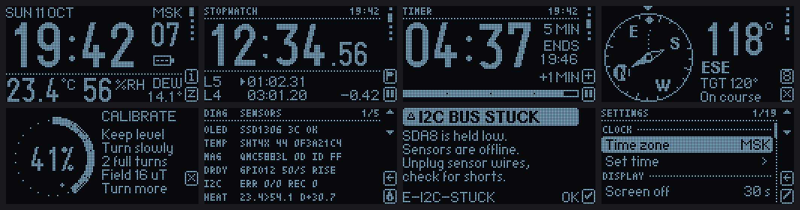

# Hiking Gadget

A pocket hiking gadget on an ESP32-S3 SuperMini: clock with time zones, stopwatch with laps,
countdown timer, compass with a target bearing and calibration, temperature and humidity.
It has a 0.96" 128×64 OLED with four buttons.



> **Status: firmware v2 is built and tested on a PC, but has not run on the hardware yet.**
> On the PC: 157 tests (3,636 checks) pass, all 85 screens are rendered by the firmware's own
> drawing code, and an automatic layout and button audit walks 1,993 UI states with 0 findings.
> The ESP32-S3 build is 478 KB with no warnings. The next step is the 24-step hardware
> checklist in [`docs/HW_CHECKLIST.md`](docs/HW_CHECKLIST.md).
>
> **How this was made.** The v2 code was written by AI coding agents in a step-by-step
> workflow, from my original brief (February 2026, quoted in [`docs/BRIEF.md`](docs/BRIEF.md))
> and the specification in [`docs/SPEC.md`](docs/SPEC.md). My part is the idea, the
> requirements and the choice of hardware; testing on the device is next.

## Hardware

| Part | Bus | ESP32-S3 pins | Address |
|---|---|---|---|
| OLED SSD1306 128×64 with 4 buttons | `Wire1`, 400 kHz | SDA 10, SCL 11; buttons 4, 5, 6, 1 | 0x3C (or 0x3D) |
| SHT45 temperature/humidity (SHT3x also works) | `Wire`, 100 kHz | SDA 8, SCL 7 | 0x44 (or 0x45) |
| GY-273 magnetometer: QMC5883L, QMC5883P or HMC5883L | `Wire`, 100 kHz | SDA 8, SCL 7; DRDY 12 (optional) | 0x0D / 0x2C / 0x1E |

The magnetometer chip is detected by its ID register, not by the board's label. A
"DA 5883" clone with a broken data-ready bit is also handled: it is read on a timer.

## How it is built

```
src/core      pure logic: time zones, stopwatch, countdown, compass maths, calibration,
              heater policy for the humidity sensor, power policy, settings, CRC, log ring
src/drivers   SHT4x/SHT3x and magnetometer drivers on top of an I2C interface
src/ui        screens, widgets and the render pipeline on top of the U8g2 C API
src/app       services and the application core: time, compass, thermo, power, console
src/hal       the only ESP32-specific layer
```

Everything except `src/hal` compiles and runs on a PC. The host build runs the whole firmware
loop against fake hardware ([`tools/host/fakes/world.h`](tools/host/fakes/world.h)): fake I2C
devices, buttons, clock and display. The same screens are rendered to PNG and compared pixel
by pixel with golden images, and the same tests can run under AddressSanitizer and UBSan.

Errors are never dropped silently. Each one has a code (`E-I2C-STUCK`, `W-MAG-SAT`,
`E-KEY-STUCK` and two dozen more) shown on the screen as a card or a status mark, with details
on the serial console. A full table is in [`README.ru.md`](README.ru.md).

The key tables in [`docs/BUTTONS.md`](docs/BUTTONS.md) are generated from the firmware, so
they always match what each button does on each screen.

## Building

**On the device:** Arduino IDE 2.x, board "ESP32S3 Dev Module" with *USB CDC On Boot:
Enabled* (the build stops with an error that names this setting otherwise), plus the U8g2
library. All settings, flashing from the browser and time sync are described in Russian in
[`README.ru.md`](README.ru.md).

**On a PC (Linux):**

```bash
tools/build.sh test        # host tests
tools/build.sh sanitize    # the same under AddressSanitizer + UBSan
tools/build.sh render      # every screen to PNG
tools/build.sh golden      # compare the screens with tools/host/golden/ pixel by pixel
tools/build.sh fw          # firmware for the ESP32-S3 (arduino-cli)
```

`tools/build.sh` points to my local arduino-cli installation; change the paths at the top for
yours.

**Time sync:** the clock is set from a PC through the browser (Web Serial,
[`tools/sync/hg_sync.html`](tools/sync/hg_sync.html), works offline) or with
[`tools/sync_time.py`](tools/sync_time.py).

## History

- **v1** (June 2026), kept in [`legacy/v1/`](legacy/v1/): the first version, five screens and
  a Wi-Fi setup portal.
- **v2** (October 2026): rewritten from scratch from the spec, with host tests, golden
  images and error codes.

## Stack

C++17 · Arduino core for ESP32 3.3 (ESP-IDF 5.5) · U8g2 · g++/make for the host build ·
Python and Web Serial for the tools

Libraries used but not included: [U8g2](https://github.com/olikraus/u8g2) (BSD 2-Clause),
[Arduino core for ESP32](https://github.com/espressif/arduino-esp32) (LGPL 2.1).

## License

[MIT](LICENSE)
